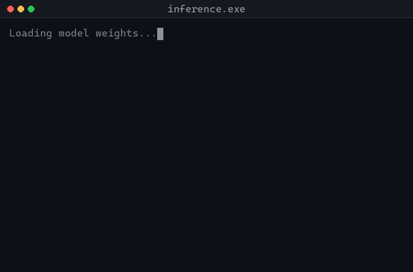
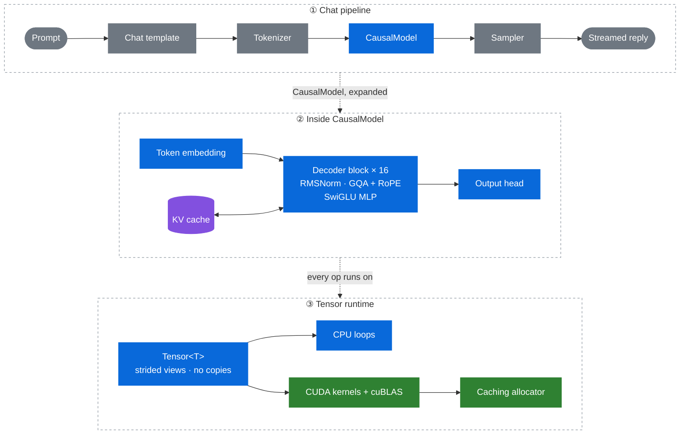
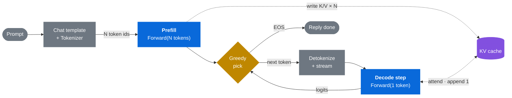

<div align="center">

# InferenceEngine

**A transformer inference engine written from scratch in C++20 and CUDA. It uses no PyTorch, no ggml and no ML libraries.**

It loads real Hugging Face checkpoints and chats with Llama 3.2 1B Instruct on an NVIDIA GPU, using its own tensor library, tokenizer and CUDA kernels.




<sub>Real recording of <code>inference.exe</code> on an RTX 4050 Laptop GPU, in real time. Only model loading is cut. Numbers are in <a href="#performance">Performance</a>.</sub>

</div>

## At a glance

- **Runs Llama 3.2 1B Instruct end to end on the GPU at ~7.8 tokens/s**, with the first token in under a second on a laptop RTX 4050. The full chat pipeline is the engine's own code: chat template → tokenizer → forward pass with KV cache → greedy decode → streamed detokenize.
- **Tested against references.** The tokenizer matches Hugging Face `tokenizers` exactly on GPT-2 and Llama 3. GPT-2 logits match Hugging Face to within **6e-5**.
- **1,385 GoogleTest cases**, 569 of them on CUDA. Every GPU op is checked against the CPU path, and so is the full model through prefill and decode.
- **Its own CUDA backend.** Every op of the forward pass runs on the GPU, including the embedding lookup, RoPE, norms, attention and the output head, on top of a caching device allocator and cuBLAS.

## Highlights

**Zero-copy views, even on the GPU.** Reshape, slice, permute, transpose and broadcast are stride changes, not copies. CUDA kernels read strided views directly through a shared layout helper. Batched `MatMul` takes broadcast batch strides plus row and column strides, so attention's `Q·Kᵀ` runs straight over a sliced KV cache with grouped-query broadcasting. Nothing is materialised.

**Grouped-query attention without repeating K/V.** MHA, GQA and MQA are one code path: a 5-D broadcast over KV-head groups. The KV cache stores the compact KV-head layout. Masked rows are filled with the lowest finite value instead of `-inf`, so fully masked rows stay finite.

**One config, many architectures.** A single `CausalModel` is assembled from `TransformerConfig`. It supports pre- or post-norm, LayerNorm or RMSNorm, plain or gated (SwiGLU) MLPs, learned or rotary positions (with `llama3` frequency scaling checked against Hugging Face), and tied or separate output heads. GPT-2 and Llama 3.2 are just presets.

**A checkpoint loader that refuses to half-load.** It reads `.safetensors` with dtype conversion (BF16/F16/F32/...) and maps names through rename rules with `{i}` layer placeholders. It checks every parameter, shape and unused tensor *before* touching the model, then moves tensors in rather than copying them.

**A caching GPU allocator.** `cudaMalloc`/`cudaFree` on every op cost more than the kernels themselves, so freed blocks are reused. Sizes are rounded to 512 B (under 1 MiB) or 2 MiB, the cache is capped at 256 MiB, it clears the cache and retries on out-of-memory, and it rejects double frees.

**A real tokenizer and real chat templates.** The tokenizer reads the model's own `tokenizer.json`: special tokens first (longest match wins), Unicode-regex pre-tokenizers (PCRE2), id-based BPE merging with a per-word cache, and BOS/EOS templates. Anything it doesn't support raises an error instead of being silently skipped. Chat templates are the model's own Jinja, rendered with [minja](https://github.com/google/minja), and match Hugging Face on Qwen2.5, SmolLM2, Gemma 2, Phi-3.5 and Mistral.

## Architecture

Every tensor carries its device. Every op dispatches on the device of its inputs and throws on mixed devices. `Module::To(Device::CUDA)` moves parameters and registered buffers (such as the RoPE tables), so the model code is identical on CPU and GPU.



One chat turn. The prompt is processed once (prefill), then each new token costs a single-token forward pass that reads the KV cache instead of recomputing the whole sequence:



| Directory | Contents |
|---|---|
| `Tensor/` | `Tensor<T>`: shapes, strides, views (reshape, slice, permute, transpose, squeeze/unsqueeze), broadcasting, batched `MatMul`, reductions, masked fill, CPU/CUDA dispatch |
| `NeuralNet/` | `Module` base (named parameters, buffers, submodules, `To(device)`), `Linear`, `Embedding`, `Sequential`, activations (ReLU, GELU, GELU-tanh, SiLU, SwiGLU, Sigmoid, Tanh, Softmax) |
| `NeuralNet/Transformer/` | `GroupQueryAttention` (MHA/GQA/MQA), `RotaryEmbedding`, `MLP`, `KVCache`, `DecoderBlock`/`Decoder`, `TransformerConfig`; `Normal/` holds `LayerNorm`, `RMSNorm`, `MakeNorm` |
| `Models/` | `CausalModel`, `Tokenizer`, `ChatTemplate`, `WeightLoader`, presets and Llama rename rules (`ModelConfigs.h`), GPT-2 checkpoint conversion |
| `Generation/` | `LogitsProcessor` pipeline, `Temperature`, `Greedy` |
| `Serialize/` | `.safetensors` reader (F32/F64/F16/BF16/int/bool), reflection-based JSON loading |
| `Reflection/` | `REFLECTABLE` macro: compile-time member names and iteration for config structs |
| `UI/` | Terminal chat UI (`ChatUI.h`): welcome banner, status line, prompt, ANSI colours and box drawing |
| `CUDA/` | Kernels and launchers (elementwise and strided ops, fill, masked fill, reductions, softmax, activations, RoPE, embedding lookup, strided copy, linear, batched strided matmul via cuBLAS) and the caching allocator |
| `tests/` | 1,385 GoogleTest cases; `tests/CUDA/` holds the GPU-versus-CPU checks |

## Performance

Measured on an NVIDIA GeForce RTX 4050 Laptop GPU (6 GB) under Windows 11. Release build, fp32 weights, greedy decoding, a short chat prompt. Timings come from the recording above, taken on the real clock.

| Llama 3.2 1B Instruct | GPU (CUDA) |
|---|---:|
| Load `.safetensors` → GPU | ~16 s |
| Time to first token | ~0.95 s |
| Decode | ~128 ms / token (~7.8 tokens/s) |
| GPU memory in use | ~5.0 GB |

**Where the remaining time goes.** Single-token decode is memory-bound: each step has to read every weight once. About 4.9 GB of fp32 weights over the 4050's ~192 GB/s of memory bandwidth puts the floor near **26 ms/token**, so the engine runs about 5× above it. The kernels so far were written for correctness, with GPU-vs-CPU parity tests, and the next steps close that gap:

- `Linear` multiplies by a transposed, strided weight view, so its reads are not coalesced. A contiguous kernel or cuBLAS is the biggest expected win.
- fp32 weights. BF16 storage halves the bytes per token, which also halves the floor.
- RMSNorm/LayerNorm are composed from ~6 kernel launches with full-size temporaries instead of one fused kernel.

The CPU path is a single-threaded reference: about 0.075 GFLOP/s in `MatMul`, and many minutes to the first token.

## Correctness

| Suite | Tests | What it checks |
|---|---:|---|
| `cuda_tests` | 569 | Every CUDA op against the CPU result, including strided, transposed and broadcast inputs; allocator behaviour; the full model on GPU vs CPU through prompt and decode steps |
| `nn_tests` | 455 | Modules, attention (MHA/GQA/MQA, masks, KV cache), RoPE scaling, norms, MLPs, decoder blocks |
| `math_tests` | 225 | Tensor views, broadcasting, batched `MatMul`, reductions |
| `serialize_tests` | 49 | `.safetensors` parsing and dtype conversion, reflection-based JSON |
| `models_tests` | 37 | Weight loading, rename rules, validation failures, chat templates |
| `generation_tests` | 35 | Logits processors, temperature, greedy sampling |
| `tokenizer_tests` | 15 | Pre-tokenizers, BPE, special tokens, round-trips |

Outside the unit suite: the tokenizer matches Hugging Face `tokenizers` exactly on GPT-2 and Llama 3, and GPT-2 logits matched Hugging Face to within 6e-5.

```
ctest --preset debug
```

## Getting started

Requirements: CMake 3.21+, a C++20 compiler (MSVC with Visual Studio 2026 or 2022 tested), vcpkg, and the CUDA Toolkit (13.x tested) for the GPU backend. vcpkg installs gtest, nlohmann-json and pcre2 from `vcpkg.json`. CMake downloads minja (header-only, pinned by hash) during configure.

```
cmake --preset default
cmake --build --preset release
cmake --build --preset debug
ctest --preset debug
```

With Visual Studio 2022, use `vs2022` and `vs2022-release`/`vs2022-debug` instead. The CUDA backend is on by default and compiles for the GPU in the build machine (`-arch=native`). To build without it, configure with `-DIE_ENABLE_CUDA=OFF`.

**Run the chat.** Put these files from [`unsloth/Llama-3.2-1B-Instruct`](https://huggingface.co/unsloth/Llama-3.2-1B-Instruct) (an ungated copy of `meta-llama/Llama-3.2-1B-Instruct`) in `Models/llama3.2-instruct/`:

- `model.safetensors`
- `tokenizer.json`
- `tokenizer_config.json` (holds the chat template)

Then run `build-vs/Release/inference.exe` from the repository root, so the relative paths resolve. Type `/clear` to reset the conversation and `/exit` to quit.

The `device` constant in `main.cpp` picks the device and is set to `tensor::Device::CUDA`. Loading peaks at about 10 GB of host memory. On the GPU, the fp32 weights take about 4.9 GB of device memory; if allocation fails, lower `contextSize`. On the CPU, the first reply takes many minutes.

## Roadmap

**Performance** is the current focus.

- [x] KV cache: reuse past keys/values so each step processes one token instead of the whole sequence
- [x] CUDA backend: every op of the forward pass, including attention, on the GPU, with a caching allocator
- [x] cuBLAS GEMM for single-batch `MatMul`
- [ ] `Linear` kernel. `Linear` multiplies by a transposed (strided) weight view, so the inner loop jumps 8–32 KB per step and cannot vectorise. A contiguous row-dot-product kernel, or cuBLAS, is the single biggest win.
- [ ] FlashAttention: fused, tiled attention that never builds the score matrix or a mask tensor. Then flash-decoding, which splits the KV sequence across blocks for single-token steps.
- [ ] BF16 weights on the GPU, accumulating in fp32. This halves Llama 3.2 1B to about 2.5 GB.
- [ ] Fused RMSNorm/LayerNorm kernels (one block per row reusing `BlockReduce`), replacing ~6 launches and 3 temporaries
- [ ] Skip the memset when a kernel overwrites its whole output
- [ ] Last-position-only output projection. Prefill computes the 128K-vocabulary logits for every prompt position (about 20% of Llama prefill) and uses only the last row.
- [ ] Prefix caching across chat turns
- [ ] CPU: multithreading, SIMD (AVX2/FMA, AVX-512), blocked `MatMul`. CPU `MatMul` reaches about 0.075 GFLOP/s today.
- [ ] Memory: load weights straight into parameters (loading peaks at about 2× model size), memory-mapped weights, no allocation in the hot loop
- [ ] Quantization: int8/int4 weights, FP16 storage

<details>
<summary><b>Architectures</b></summary>

- [x] RoPE, with `default`, `linear` and `llama3` frequency scaling
- [ ] Remaining RoPE scaling types: dynamic NTK, YaRN, LongRoPE (currently rejected)
- [x] Grouped-query and multi-query attention
- [x] Gated MLP (SwiGLU) and config-driven norm/activation/placement selection
- [ ] QK-norm (Qwen3, Gemma 3), sandwich norms and `(1 + w)` RMSNorm (Gemma)
- [ ] Mixture of Experts: router, expert dispatch, top-k gating
- [ ] Sliding-window and chunked attention
- [ ] Encoder and encoder-decoder support (cross-attention)

</details>

<details>
<summary><b>Models</b></summary>

- [x] Config-driven model: one generic `DecoderBlock`/`Decoder`/`CausalModel` assembled from `TransformerConfig`
- [x] Generic weight loader: rename rules with `{i}` layer indices, all-or-nothing loading with missing/unused/shape checks
- [x] GPT-2 checkpoint conversion (Conv1D transposes, fused QKV split, mask buffers dropped) and Llama rename rules
- [ ] More families: Qwen2/2.5, Mistral, SmolLM, Gemma
- [ ] Hugging Face `config.json` → `TransformerConfig` translation, and picking the weight adapter from `"architectures"`
- [ ] Sharded checkpoints (`model-00001-of-*.safetensors` + index)

</details>

<details>
<summary><b>Tokenizers</b></summary>

- [x] Generic `tokenizer.json` BPE: added tokens, `Split`/`ByteLevel`/`Sequence` pre-tokenizers, both merge formats, `TemplateProcessing` BOS/EOS, `ByteLevel` decoder. Matches Hugging Face exactly on GPT-2 and Llama 3.
- [x] Special-token matching before splitting; BOS/EOS post-processing
- [x] Chat templates: the model's own Jinja template rendered with minja
- [ ] Normalizers (NFC/NFKC, lowercase), `Metaspace` and `byte_fallback` for SentencePiece-style BPE (Llama 2, Mistral, Gemma)
- [ ] Unigram and WordPiece models
- [ ] Streaming-safe decode: hold back incomplete UTF-8 sequences between tokens

</details>

<details>
<summary><b>Generation</b></summary>

The decoder is a composable logit pipeline (penalties → temperature → truncation → sample), so each stage stays independent and testable.

- [x] Greedy search. Deterministic, so it is the only mode that gives bit-exact regression tests. On its own it falls into repetition loops.
- [x] `LogitsProcessor` pipeline
- [x] Temperature
- [ ] Top-k, top-p (nucleus) and min-p sampling
- [ ] Repetition, frequency and presence penalties
- [ ] Beam search with length normalisation
- [ ] Contrastive search
- [ ] Seeded RNG so sampled runs stay reproducible
- [x] Multiple stop tokens and token-by-token streaming output
- [x] Multi-turn chat with history trimming to the context window
- [ ] Stop sequences (multi-token strings)
- [ ] Reusable chat session class instead of the loop in `main.cpp`
- [ ] Batched generation
- [ ] Speculative decoding

</details>

<details>
<summary><b>Correctness and tooling</b></summary>

- [ ] Reference-parity harness: compare per-layer activations and logits against Hugging Face for each supported model
- [ ] Benchmarks: tokens/sec, time to first token, memory, per-layer timing
- [ ] CLI with model-directory/prompt/sampling flags instead of hard-coded paths; optional server API

</details>

## Acknowledgements

Chat templates are rendered with [minja](https://github.com/google/minja). Regex pre-tokenization uses [PCRE2](https://github.com/PCRE2Project/pcre2). JSON parsing uses [nlohmann/json](https://github.com/nlohmann/json). Tests use [GoogleTest](https://github.com/google/googletest).
